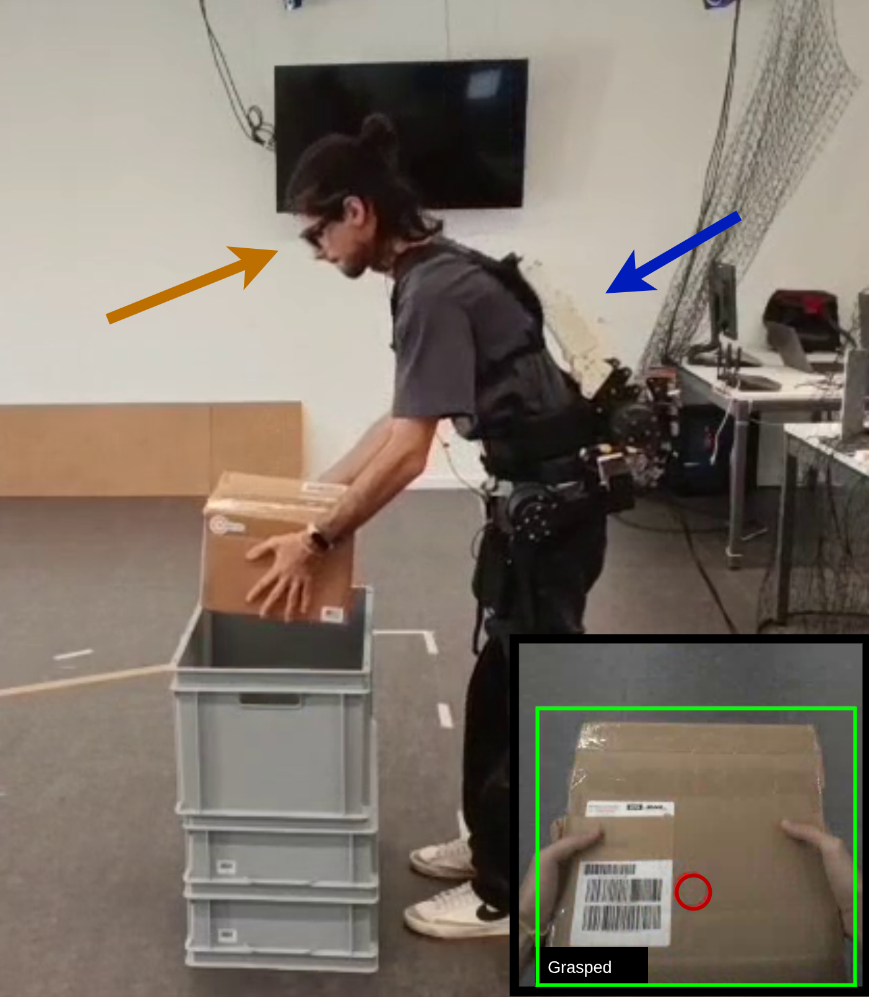
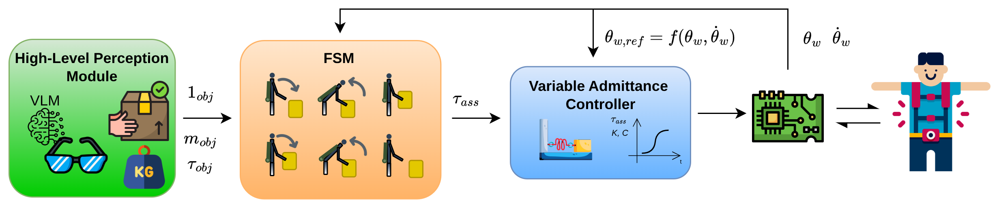

# Context-Aware Exoskeleton Assistance

Egocentric vision and gaze tracking for an active back-support exoskeleton.
This research project connects **what the wearer sees**, **the lifting phase**,
and **variable-admittance control** to inform assistance during manual handling.

**ROS 2 Humble · Python · Moteus · Tobii Glasses 3 · YOLO · Qwen2.5-VL**

[Project overview](https://alessandro-leanza.github.io/projects/exoskeleton/) ·
[Preprint](https://arxiv.org/abs/2602.04648) ·
[Research results](docs/RESEARCH.md) ·
[Setup guide](docs/SETUP.md)

  
   
  <em>Laboratory lifting task with wearable perception and active back support.</em>

## What this repository contains

- **Wearable perception:** Tobii scene video and gaze, YOLO grasp-state detection,
  and a ROS interface for assistance gating.
- **Assistive control:** a pick/place finite-state machine, variable admittance,
  gravity and configured-load compensation, torque slew limits, and telemetry.
- **Perception experiments:** a YOLO → region of interest → Qwen2.5-VL pipeline
  with image/video benchmarks for weight and fragility categories, trigger rates,
  and inference latency.

## How it works

  

1. **Observe:** acquire the wearer's scene video and gaze; detect grasped and
   released objects.
2. **Interpret:** use gaze and grasp state to publish an assistance gate.
   The experimental VLM pipeline also produces object-property estimates.
3. **Assist:** combine the perception gate and joint feedback with a finite-state
   policy to generate assistive commands for the two Moteus drives.

The figure presents the research architecture. In the current code, VLM outputs
are logged; the controller uses a configured payload mass (`m_b`). Automatic
VLM-to-payload adaptation is not connected in this snapshot. See
[implementation scope](docs/RESEARCH.md#implementation-scope) for details.

## Selected results

Reported findings from controlled laboratory stooping and lifting tasks:

| Evaluation | Finding | Scope |
| --- | --- | --- |
| Gaze ablation | **1.826 s earlier** mean payload-aware assistance onset with gaze | One participant; 50 randomized trials per condition; onset referenced to YOLO grasp detection. |
| Perceived physical demand | **3.60 / 4** with vision, **2.13 / 4** with posture-only assistance, **2.00 / 4** without the exoskeleton; higher is better | 15 participants; five repetitions per condition. |
| Preliminary EMG | **14.29% thoracic** and **14.63% lumbar** reduction in erector-spinae envelope RMS | Five participants; complete vision-enabled exoskeleton versus no exoskeleton during loaded lifting. |

The EMG comparison does not isolate the contribution of gaze or vision. These
studies do not establish generalization to arbitrary users or environments.
[Full measurements, comparisons, and limitations](docs/RESEARCH.md#experimental-results)
are documented separately. The linked preprint is an earlier version and may
not contain all the results shown here.

## Explore the code

| Area | Start here |
| --- | --- |
| Live scene video, gaze, and perception gate | [`tobii_vlm/__main__.py`](exo_control/exo_control/tobii_vlm/__main__.py) |
| Assistance policy and admittance controller | [`admittancecontrol_box.py`](exo_control/exo_control/admittancecontrol_box.py) |
| Dual-drive CAN communication and joint feedback | [`moteus_control_node.py`](exo_control/exo_control/moteus_control_node.py) |
| ROI selection, VLM inference, and output parsing | [`pipeline/`](exo_control/exo_control/pipeline/) |
| Offline image/video evaluation | [`test_pipeline.py`](exo_control/exo_control/test_pipeline.py) |
| Custom ROS services | [`exo_interfaces/srv/`](exo_interfaces/srv/) |
| Motor configuration and calibration notes | [`exo_config/moteus/`](exo_config/moteus/) |

## Getting started

**Explore perception without the exoskeleton.** The
[offline benchmark guide](docs/OFFLINE_BENCHMARK.md) covers image/video inputs, model
weights, configuration, and CSV outputs. It requires the ML environment and your
own inputs, but does not launch ROS or motor control.

**Run the laboratory stack.** Follow the [setup guide](docs/SETUP.md) for the ROS
workspace, required hardware, model paths, and launch commands. The repository
uses a laboratory-specific environment; a pinned, standalone installation is
not yet provided. The default live YOLO weight file is not tracked in Git.

## Related research

Alessandro Leanza, Paolo Franceschi, Blerina Spahiu, and Loris Roveda.
[*From Vision to Assistance: Gaze and Vision-Enabled Adaptive Control for a
Back-Support Exoskeleton*](https://arxiv.org/abs/2602.04648), arXiv:2602.04648,
2026.

Figure sources and reuse notes are in [images/README.md](images/README.md).
